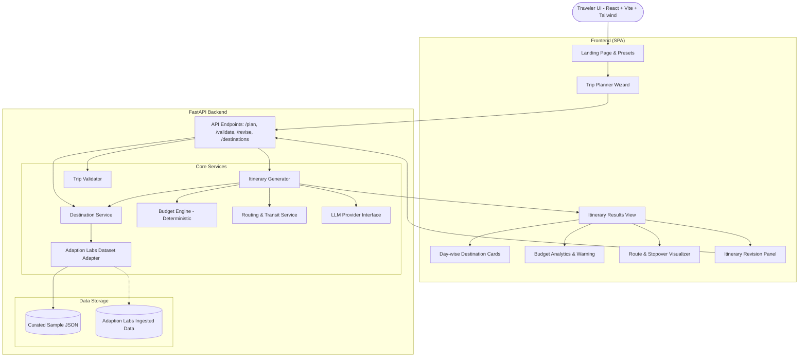

# Karnataka Yatra AI - System Architecture

Karnataka Yatra AI is a modular, AI-powered travel planning engine designed for hackathon-grade performance and real-world scalability. It creates realistic, budget-conscious, and regionally clustered itineraries across Karnataka with multilingual support.

---

## Architectural Principles

### 1. Separation of Concerns
- **Destination Retrieval & Filtering** (`destination_service.py`): Queries destinations by tags, interests, region, duration feasibility, and entry budget.
- **Deterministic Budget Engine** (`budget_service.py`): Enforces pure, testable math for tiering (Budget, Balanced, Luxury/Adventurous), splits costs into lodging, meals, transport, entry fees, and safety buffer.
- **Itinerary Generator** (`itinerary_service.py`): Sequences days logically using geographic clustering (e.g. Coastal vs Heritage vs Western Ghats) so travelers don't spend entire days backtracking.
- **Validation Layer** (`validation_service.py`): Runs independent checks to verify if total budget is exceeded, daily pace is realistic, or travel duration is violated.
- **LLM Provider Abstraction** (`llm_provider.py`): Pluggable interface (`BaseLLMProvider`) supporting:
  - `DeterministicProvider` (Default, no API key required)
  - `GeminiProvider` (Ready for Gemini 1.5 Flash / Pro via API key)
- **Routing Service Abstraction** (`routing_service.py`): Pluggable interface (`BaseRoutingService`) calculating distances and travel times between Karnataka regional hubs.

### 2. Dataset Loader for Adaption Labs
Rather than assuming a rigid column schema before Adaption Labs delivers the dataset, `DatasetLoader` uses a flexible mapping strategy with fallbacks and Pydantic validation:
- Detects field synonyms (e.g. `place_name`, `name`, `title`; `cost`, `entry_fee`, `price`).
- Marks sample and estimated data with `is_sample_or_estimated=True`.
- Rejects invalid records safely without crashing the server.

### 3. Reliability & Transparency
- Verified prices vs. estimates are clearly flagged in the response payload.
- Warning flags (`budget_exceeded`, `pace_warning`, `monsoon_advisory`) are communicated to the frontend transparently.
- No imaginary timetables or fabricated train schedules.
